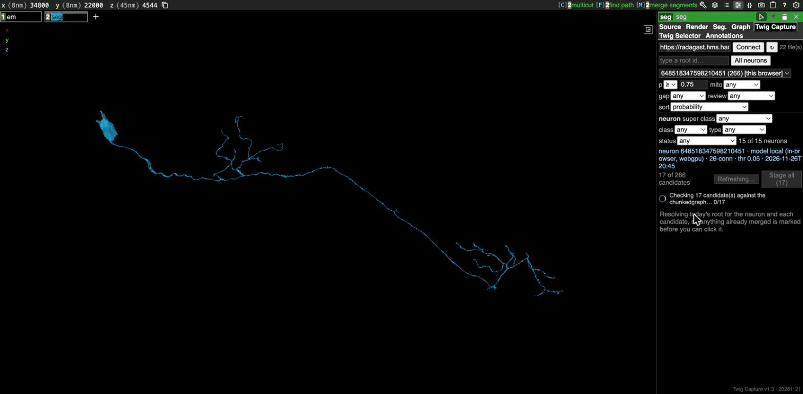
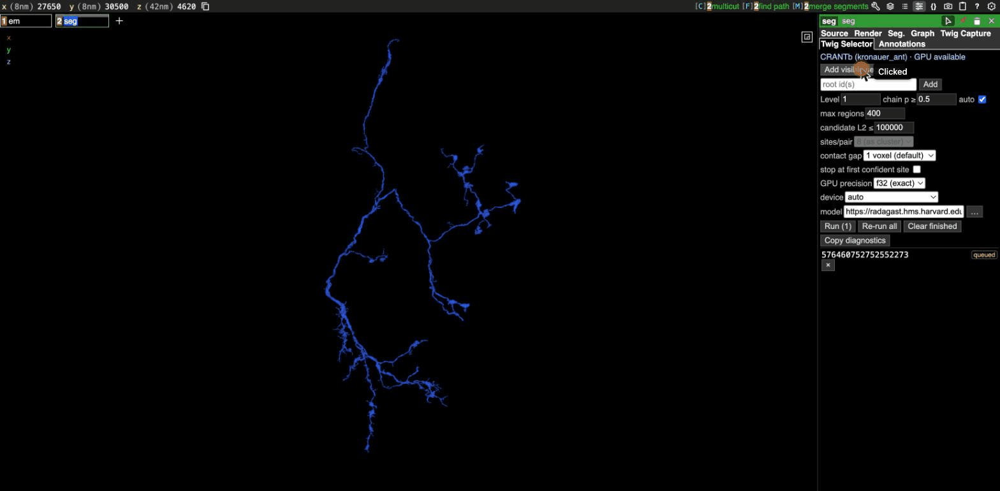
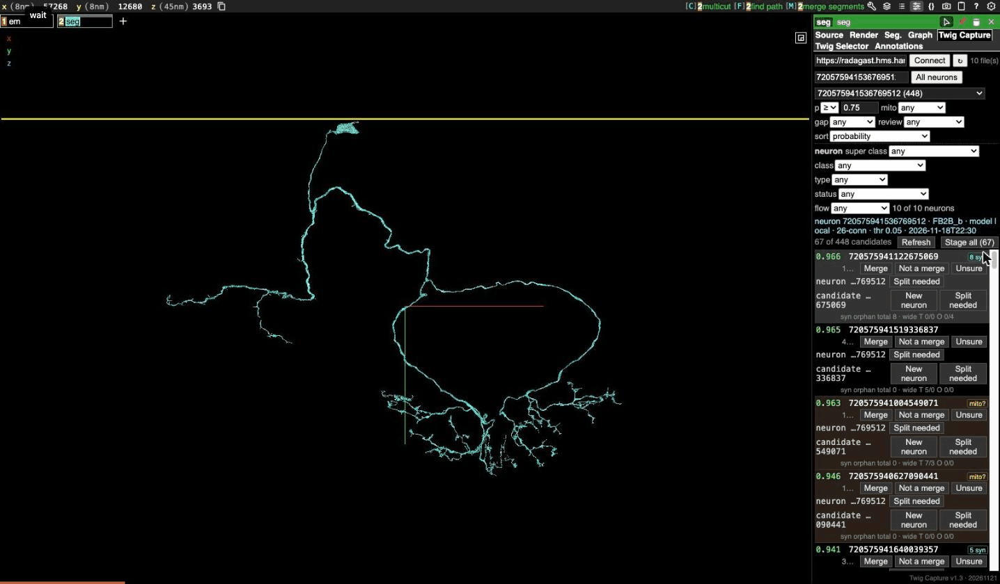
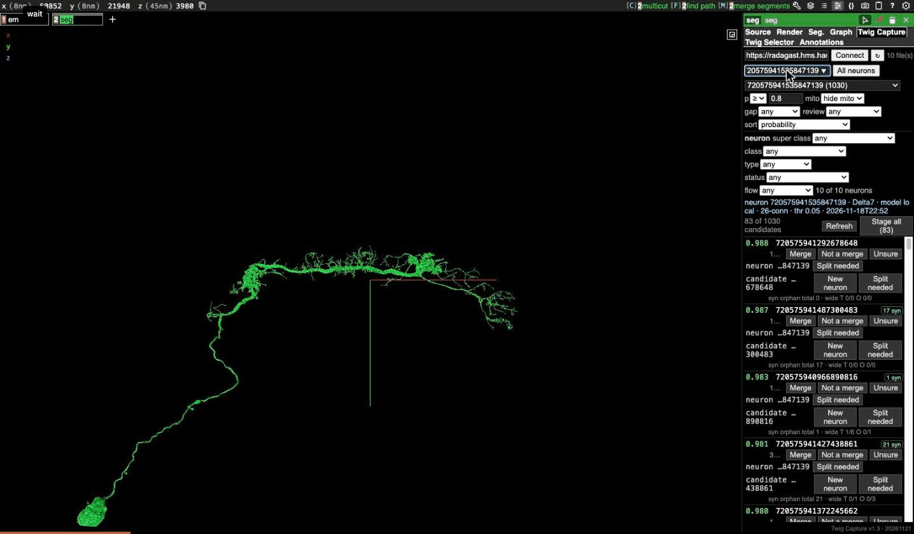

# Twig Capture: merge suggestions in the browser



*Aedes `648518347598210451`, a small neuron (166 L2 nodes). Merge candidates
are predicted on this laptop's GPU at level 1: 107 regions in about 20
minutes, 266 suggestions. The GIF is a time-lapse while the model runs. The
17 at p ≥ 0.75 are staged with **Stage all**. One, tagged **large merge**,
is a whole other neuron with its own soma, so it is unticked. The other 16
add large pieces of the neuron's terminal arbor. The cursor rests on
**Merge staged** without clicking it.*



*CRANTb `576460752752552273` (177 L2 nodes), the same flow on the ant
dataset: 120 regions in about 70 minutes, 958 suggestions. The 85 at
p ≥ 0.75 are staged. One, tagged **large merge** (2,453 synapses), is a
bushy mass that is not part of this neuron and is unticked. The other 84
(3,872 synapses) fill in branches all along the neuron. The cursor rests on
**Merge staged** without clicking it.*

**BANC.** Every BANC neuron with cluster results is large, so these two
show the review tab on those results (model `banc_v2.0`) rather than a
prediction in the browser. Neither neuron has been edited since its run.



*BANC FB2B_b `720575941536769512` (226 L2 nodes searched, 448
suggestions). The **mito** filter is set to **hide mito**, and the 37
remaining suggestions at p ≥ 0.75 (173 synapses, 9 with 5 or more L2
nodes) are staged with **Stage all**. The view then zooms in on the
dendrites, where most of them sit. The cursor rests on **Merge staged**
without clicking it.*



*BANC Delta7 `720575941535847139` (403 L2 nodes searched, 1,030
suggestions, 204 of them at p ≥ 0.75). With mito hidden, the 83 at
p ≥ 0.8 are staged (240 synapses, up to 20 L2 nodes each). The list shows
at most 100 rows, so a higher threshold keeps the whole set in one stage.
The view zooms in on the arbour, where a large fragment (light blue) and
many smaller ones are added. Nothing is merged.*

## Links

| dataset | viewer |
|---|---|
| BANC | https://radagast.hms.harvard.edu/twigcapture_banc/ |
| Aedes | https://radagast.hms.harvard.edu/twigcapture_aedes/ |
| CRANTb | https://radagast.hms.harvard.edu/twigcapture_crantb/ |
| FANC | https://radagast.hms.harvard.edu/twigcapture_fanc/ (new, see below) |

Each link opens its dataset, with the Twig Capture tab connected to the
cluster results of that dataset's newest model, served beside the viewer
(`twigcapture_<dataset>/results/`). Sign in to CAVE when asked (CRANTb has
its own login).

**Results folders.** On O2, `twig_capture/viewers/results_<dataset>/` holds
links to the newest model's result files plus `index.json` and
`candidates.json.gz` (`make_results_index.py`, for the root picker and "All
neurons") and `neurons.json` (`make_seatable_meta.py`, for the SeaTable
filters). Today: BANC `banc_v2.0` (banc_finetune 2026-11-13), Aedes
`aedes_v2.0_test` (aedes_finetune 2026-11-13), CRANTb
`crantb_test_aedes_v2.1`. When a newer model's results land, relink the
folder and re-run both scripts.

**FANC** (`fanc_production_mar2021`) is new:
- **Cluster results** (`results_fanc/` -> `twig_capture/fanc_v1`): 297
  proofread FANC neurons (in `proofread_first_pass` or
  `proofread_second_pass`), drawn from the cell-info table
  `neuron_information` by twigcapture `scripts/fanc/select_inference_neurons.py`:
  150 central (50 ascending, 50 descending, 50 other), 80 sensory, 60 motor
  and 7 efferent non-motor, each 50-1,500 L2 nodes. Run on O2 CPUs with
  the joint model (`joint_finetune_20261123_105038` ep8), threshold 0.05.
  The list and its labels are `inference_v1.txt` / `.csv` in that folder.
  Neuron filters come from `neuron_information` (identity, primary class,
  hemilineage), proofreading status from the two proofread tables, and
  flow from primary class (ascending / descending from the projection tag).
- **Decisions are recorded.** FANC's `twig_capture_decisions` table was
  created on 2026-11-27 (twigcapture
  `scripts/cave/create_twig_capture_tables.py --dataset fanc --create`), and
  FANC is on the decisions allowlist (`twig_capture_decisions.ts`), so the
  verdict buttons work as on the other datasets. `ctr` is written on an
  8.6 × 8.6 × 45 nm grid. FANC's aligned volume is `fanc_v4`, not its
  datastack name, so the writer maps it (`alignedVolume`).
- **Resolution.** FANC has no 32 nm supervoxel mip, so it runs at 34.4 nm
  (supervoxels) and 8.6 nm (EM), keeping the model's 1:4 ratio. Each patch
  therefore covers about 7.5% more tissue than in training, and no model has
  seen FANC yet, so treat FANC probabilities as uncalibrated until a model
  trained with FANC data (see twigcapture `docs/fanc/PLAN.md`) is published.

## Predicting merges for your own neurons

1. Select the segmentation layer and open the **Twig Selector** tab.
2. Queue neurons in any of these ways:
   - **Add visible segments**;
   - paste root ids;
   - point at a neuron and press **Alt+T** (Option+T on a Mac). This queues
     the neuron and starts the model.
3. Press **Run**. Every queued neuron runs in turn, on the GPU (WebGPU)
   where there is one, otherwise on the CPU (slower, but it works).
4. **Open in Twig Capture** shows the suggestions. To work on several
   neurons at once, tick them and use **Open ticked together**.
5. Review as usual: **Merge**, **Not a merge**, **Unsure**, **New neuron**,
   **Split needed**. Or **Stage all → Merge staged**: staging edits nothing,
   so untick what you don't want before merging.

Everything runs and is cached in your browser: the model is downloaded once,
and results survive a reload. Verdicts are still recorded in the dataset's
`twig_capture_decisions` CAVE table, as for cluster results.

**Contact gap.** Pieces up to 1 supervoxel voxel (32 nm) apart count as
touching by default, as the cluster runner's `--contact_gap 1`. This finds
merges across a thin gap, such as a neck that vanishes at 32 nm. Those rows
are tagged **gap** in Twig Capture (filter them with the gap facet), and
they are less reliable than touching ones. Pairs that really touch are
scored exactly as without the gap. The **contact gap** setting offers 0
(touching only), 1 or 2.

**Level.** Level 1 suggests merges onto the neuron. Level 2 also suggests
merges onto the confident level-1 suggestions (p ≥ the chain threshold),
and so on. Those rows say which suggestion they attach to ("via").

**Speed.** The model runs on Twig Capture's own WebGPU network (adapted
from Philipp Schlegel's Coda, see Acknowledgements): about 41 ms per patch
on an Apple M1 Max, against 81 ms with ONNX Runtime. EM for the next
regions is fetched and cut out while the GPU scores the current one. Aedes
`648518347555976042` (36 regions, 2,477 patches) went from 512 s to about
150 s, with identical suggestions. Expect about 7 s per region, so a few minutes for a small
neuron and longer for a big one. On the CPU, expect about 3 s per patch.
There, set sites/pair to 1 and cap max regions. The **device** setting can
also pick **GPU (ONNX Runtime)**, the previous GPU path.

## Something went wrong?

Press **Copy diagnostics**, or **Copy report** next to a failed neuron, and
paste the text into a message to us. It holds your browser and OS, GPU
details, the settings, the error and a short run log. It contains no login
tokens.

## Updating the in-browser model

When twigcapture has a newer checkpoint (Kevin's runs are in
`kd193/automergeproof/models/models_local/<run>/local_classifier_ckpt_<N>.pth`;
the newest one used for cluster results is named in `configs/<dataset>.yaml`,
`models.local_model_path`):

1. **Build and publish it** (on O2, from this folder of a neuroglancer-tc
   checkout):

   ```bash
   sbatch scripts/build_browser_model.sh <ckpt.pth> [name]
   ```

   The job exports the checkpoint to ONNX, rewrites every Conv3d as Conv2d
   (WebGPU is about 40× faster on it), and checks the result against
   PyTorch. It fails if they differ by more than 1e-4. It then publishes
   `https://radagast.hms.harvard.edu/twigcapture_dev/models/<name>/local_fp32c2d.onnx`
   with a `MODEL.txt` recording the checkpoint, the sha256 and the check.
   The name defaults to `<run>_ep<N>`, and a published name is never
   overwritten.
2. **Try it:** paste that URL into the Twig Selector's **model** field.
   Results record the model URL (`local_model`), and a result made with a
   different model is not reused.
3. **Make it the default:** set `DEFAULT_MODEL_URL` in
   `src/layer/segmentation/twig_inference/datasets.ts` to the new URL,
   commit, and redeploy (`deploy/deploy.sh`).

Each model needs its own URL because browsers cache the model by URL:
replacing a file in place would leave browsers scoring with the old copy.

**Which models so far**

| name | checkpoint | notes |
|---|---|---|
| `joint_finetune_20261123_105038_ep8` | Kevin's joint Aedes+BANC fine-tune on reviewer decisions, epoch 8 | the current default (also served as `twigcapture_dev/local_fp32c2d.onnx`) |

## For developers

See [BRIEF.md](BRIEF.md) for how it works, what has been measured against
the cluster runner, and how to rebuild the model. `deploy/deploy.sh`
builds and deploys the three viewers.

## Acknowledgements

The in-browser GPU model (`src/layer/segmentation/twig_inference/gpu/`) is
adapted from **Philipp Schlegel's** hand-written WebGPU 3D ResNet in
[Coda](https://github.com/navis-org/coda) (`src/packs/seam/gpuAssessor`,
MIT licence, Copyright (c) 2026 NAVis). Philipp found that ONNX Runtime
Web runs 3D convolutions through a naive shader, and replaced it with an
implicit-matrix-multiply convolution in WGSL. We use his ONNX reader, his
convolution, split-reduction and epilogue shaders (generalised from cubes
to our 18 × 128 × 128 patch and (3, 7, 7) stem), and his in-flight scoring.
Each ported file carries his MIT notice.

