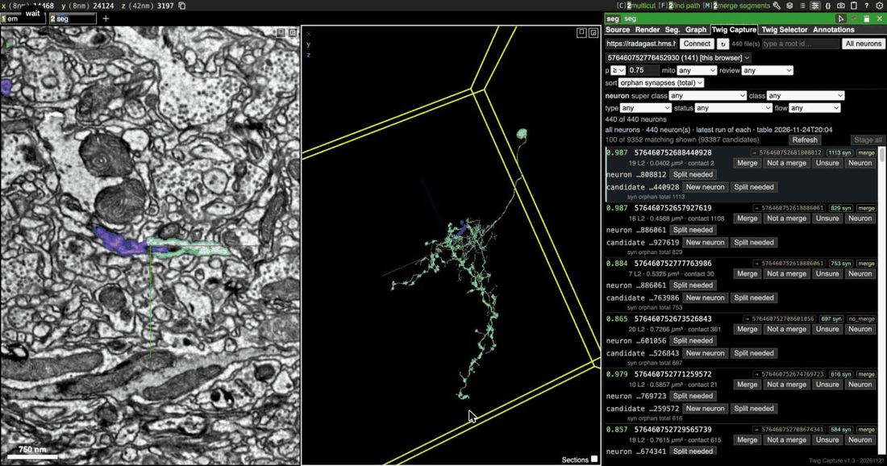

# Twig Capture: merge suggestions in the browser


*BANC SNpp47 `720575941544177124` has 100 L2 nodes, against a median of 150
for the 30 other neurons of its type. The neuron is queued in the **Twig
Selector**, and merge candidates are predicted on this laptop's GPU. The
clock shows real time: 13:05 for all 57 regions. The GIF is a time-lapse
while the model runs. The 63 candidates at p ≥ 0.9 are then staged with
**Stage all**. The cursor rests on **Merge staged** without clicking it.*



*CRANTb `576460752626597271` (410 L2 nodes), the same flow on the ant
dataset. The neuron is queued in the **Twig Selector** and merge candidates
are predicted on this laptop's GPU. The clock shows real time: 35:09 for all
237 regions, 604 suggestions. The GIF is a time-lapse while the model runs.
The 22 candidates at p ≥ 0.9 (pieces of up to 19 L2 nodes) are then staged
with **Stage all**. The cursor rests on **Merge staged** without clicking
it.*

## Links

| dataset | viewer |
|---|---|
| BANC | https://radagast.hms.harvard.edu/twigcapture_banc/ |
| Aedes | https://radagast.hms.harvard.edu/twigcapture_aedes/ |
| CRANTb | https://radagast.hms.harvard.edu/twigcapture_crantb/ |
| FANC | https://radagast.hms.harvard.edu/twigcapture_fanc/ (in-browser only, see below) |

Each link opens its dataset, with the Twig Capture tab connected to the
cluster results of that dataset's newest model, served beside the viewer
(`twigcapture_<dataset>/results/`). Sign in to CAVE when asked (CRANTb has
its own login).

**Results folders.** On O2, `twig_capture/viewers/results_<dataset>/` holds
links to the newest model's result files plus `index.json` and
`candidates.json.gz` (`make_results_index.py`, for the root picker and "All
neurons") and `neurons.json` (`make_seatable_meta.py`, for the SeaTable
filters). Today: BANC `banc_v2.0` (banc_finetune 2026-11-13), Aedes
`aedes_v2.0_test` (aedes_finetune 2026-11-13), CRANTb
`crantb_test_aedes_v2.1`. When a newer model's results land, relink the
folder and re-run both scripts.

**FANC** (`fanc_production_mar2021`) is new and in-browser only for now:
- **No cluster results yet** (no `results_fanc/`), so the viewer opens on
  the Twig Selector, and the Twig Capture tab lists only what you predict
  in this browser.
- **No `twig_capture_decisions` table on FANC yet.** Creating it (twigcapture
  `scripts/cave/create_twig_capture_tables.py --dataset fanc --create`)
  awaits approval. Until it exists, FANC is left out of the decisions
  allowlist (`twig_capture_decisions.ts`). The review tab then hides the
  verdict buttons (**Not a merge**, **Unsure**, **New neuron**, **Split
  needed**) and the review filter, and writes nothing to CAVE. **Merge** and
  **Stage all → Merge staged** still work: they are ordinary chunkedgraph
  merges, just not recorded as decisions.
- **Resolution.** FANC has no 32 nm supervoxel mip, so it runs at 34.4 nm
  (supervoxels) and 8.6 nm (EM), keeping the model's 1:4 ratio. Each patch
  therefore covers about 7.5% more tissue than in training, and no model has
  seen FANC yet, so treat FANC probabilities as uncalibrated until a model
  trained with FANC data (see twigcapture `docs/fanc/PLAN.md`) is published.

## Predicting merges for your own neurons

1. Select the segmentation layer and open the **Twig Selector** tab.
2. Queue neurons in any of these ways:
   - **Add visible segments**;
   - paste root ids;
   - point at a neuron and press **Alt+T** (Option+T on a Mac). This queues
     the neuron and starts the model.
3. Press **Run**. Every queued neuron runs in turn, on the GPU (WebGPU)
   where there is one, otherwise on the CPU (slower, but it works).
4. **Open in Twig Capture** shows the suggestions. To work on several
   neurons at once, tick them and use **Open ticked together**.
5. Review as usual: **Merge**, **Not a merge**, **Unsure**, **New neuron**,
   **Split needed**. Or **Stage all → Merge staged**: staging edits nothing,
   so untick what you don't want before merging.

Everything runs and is cached in your browser: the model is downloaded once,
and results survive a reload. Verdicts are still recorded in the dataset's
`twig_capture_decisions` CAVE table, as for cluster results.

**Level.** Level 1 suggests merges onto the neuron. Level 2 also suggests
merges onto the confident level-1 suggestions (p ≥ the chain threshold),
and so on. Those rows say which suggestion they attach to ("via").

**Speed.** On an Apple M-series GPU it takes about 10–15 s per region, so a
few minutes for a small neuron and longer for a big one. On the CPU, expect
about 3 s per patch. There, set sites/pair to 1 and cap max regions.

## Something went wrong?

Press **Copy diagnostics**, or **Copy report** next to a failed neuron, and
paste the text into a message to us. It holds your browser and OS, GPU
details, the settings, the error and a short run log. It contains no login
tokens.

## Updating the in-browser model

When twigcapture has a newer checkpoint (Kevin's runs are in
`kd193/automergeproof/models/models_local/<run>/local_classifier_ckpt_<N>.pth`;
the newest one used for cluster results is named in `configs/<dataset>.yaml`,
`models.local_model_path`):

1. **Build and publish it** (on O2, from this folder of a neuroglancer-tc
   checkout):

   ```bash
   sbatch scripts/build_browser_model.sh <ckpt.pth> [name]
   ```

   The job exports the checkpoint to ONNX, rewrites every Conv3d as Conv2d
   (WebGPU is about 40× faster on it), and checks the result against
   PyTorch. It fails if they differ by more than 1e-4. It then publishes
   `https://radagast.hms.harvard.edu/twigcapture_dev/models/<name>/local_fp32c2d.onnx`
   with a `MODEL.txt` recording the checkpoint, the sha256 and the check.
   The name defaults to `<run>_ep<N>`, and a published name is never
   overwritten.
2. **Try it:** paste that URL into the Twig Selector's **model** field.
   Results record the model URL (`local_model`), and a result made with a
   different model is not reused.
3. **Make it the default:** set `DEFAULT_MODEL_URL` in
   `src/layer/segmentation/twig_inference/datasets.ts` to the new URL,
   commit, and redeploy (`deploy/deploy.sh`).

Each model needs its own URL because browsers cache the model by URL:
replacing a file in place would leave browsers scoring with the old copy.

**Which models so far**

| name | checkpoint | notes |
|---|---|---|
| `joint_finetune_20261123_105038_ep8` | Kevin's joint Aedes+BANC fine-tune on reviewer decisions, epoch 8 | the current default (also served as `twigcapture_dev/local_fp32c2d.onnx`) |

## For developers

See [BRIEF.md](BRIEF.md) for how it works, what has been measured against
the cluster runner, and how to rebuild the model. `deploy/deploy.sh`
builds and deploys the three viewers.
